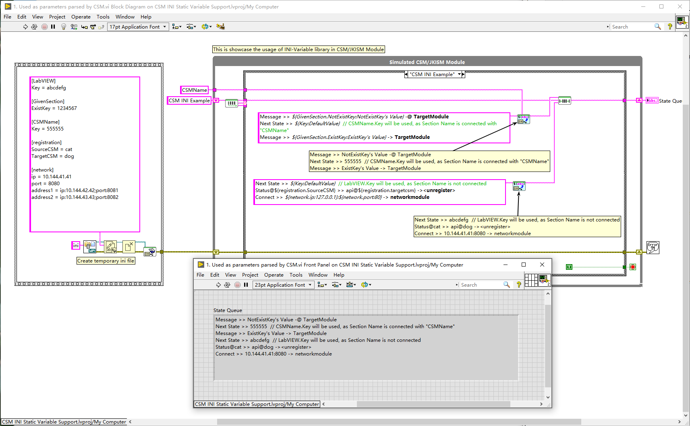
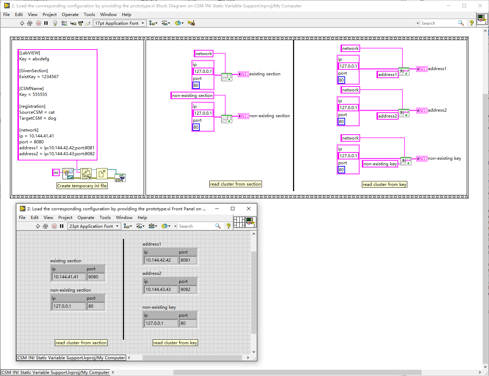
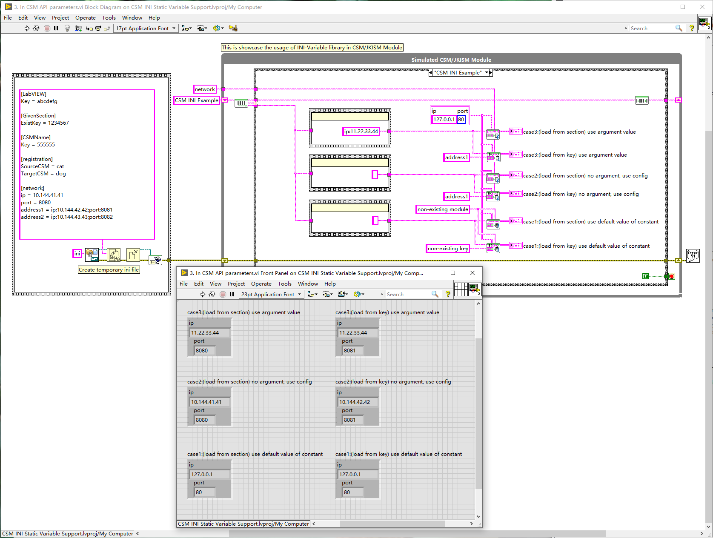
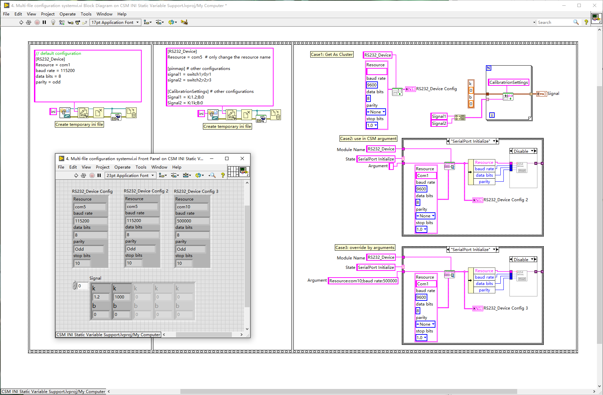
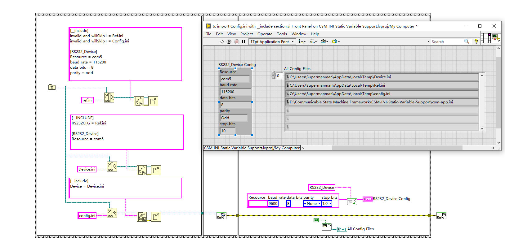
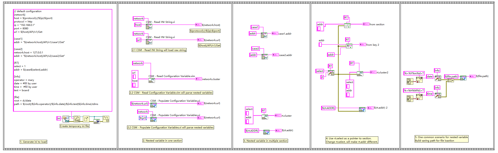

# CSM-INI-Static-Variable-Support

[English](./README.md) | [中文](./README(zh-cn).md)

[](https://www.vipm.io/package/nevstop_lib_csm_ini_static_variable_support/)
[](https://www.vipm.io/package/nevstop_lib_csm_ini_static_variable_support/)
[](https://github.com/NEVSTOP-LAB/CSM-INI-Static-Variable-Support/releases)

配置文件是应用程序开发中不可或缺的组成部分。本库为 CSM 提供简单易用的配置文件支持，使用户无需显式读写配置文件即可完成应用程序的配置。

## 安装

通过 VIPM 安装本库。安装完成后，即可在 CSM Addon 函数选板中找到相关函数。

## 架构设计

CSM INI-Static-Variable-Support 库的架构设计如下图所示：



主要特点包括：

1. **默认配置处理**：首次调用库函数时自动加载默认配置文件，无需用户显式加载。
2. **多文件支持**：通过专用函数支持加载多个配置文件。
3. **内存缓存**：在内存中维护缓存副本，应用程序从缓存中读取配置信息。
4. **INI 格式兼容**：配置文件和内存缓存均采用标准 INI 格式，支持节和键值对。
5. **高效缓存机制**：使用全局修改标记，仅在配置发生变更时才刷新缓存，从而优化读取性能。

> [!IMPORTANT]
> **开源声明**: 本库包含并使用了由 [@rcpacini](https://github.com/rcpacini) 开发的 [LabVIEW-Config](https://github.com/rcpacini/LabVIEW-Config) 的副本。

> [!NOTE]
> **默认配置文件位置**：
>
> - 开发状态：Application Directory 中找到的第一个 INI 文件。若不存在，则默认为 `csm-app.ini`。
> - 编译后：EXE 所在目录中与可执行文件同名的 INI 文件（LabVIEW 编译时会自动生成）。

> [!NOTE]
> **多文件配置**：
>
> - 加载多个文件时，后加载的文件会覆盖先前文件中的同名配置项。
> - 将缓存保存到文件时，修改会写入最后加载的配置文件。

> [!WARNING]
> 本库使用全局缓存修改标志，频繁的配置更改会降低读取 VI 中缓存机制的有效性。不建议在需要频繁修改配置的场景中使用本库。

## 配置文件注释

配置文件支持整行注释与行尾注释。

```ini
; 整行注释
# 整行注释

[network]
ip = 192.168.0.1        ; 行尾注释
port = 8080             # 行尾注释
```

> [!NOTE]
> **整行注释**
>
> - 首个非空白字符为 `;` 或 `#` 的行是注释行：读取时跳过，也不会被 `CSM - Read Sections.vi` 或 `CSM - Read Key Names.vi` 返回。
> - 既不是 `[节名]`、也不是 `键 = 值`、也不是续行的行同样按注释处理，因此不含 `=` 的 `//` 行作用相同。
> - 以空白开头、之后的首个字符不是 `#`、`;`、`=` 的行，是上一个键的续行（多行值）。只有在值确实需要多行时才缩进。
> - 注释行保留在内存缓存中，`CSM - Sync Configuration Variables to File.vi` 写回文件时保留。空行在载入时被丢弃，不会被恢复。

> [!WARNING]
> **行尾注释只在数值与布尔读取时被剥离**
>
> - `port = 8080 ; 说明` 按 I32、U32、DBL 或布尔读取时得到 `8080`。
> - 同一行按字符串读取时得到 `8080 ; 说明`，因为字符串读取保留值后面的文本。
> - 写入某个键时，该行 `=` 之后的内容（包括原有的行尾注释）会被整体替换。

> [!NOTE]
> **值的引号**
>
> - 值首尾的空白会被去除。
> - 值以同一个引号字符（`"` 或 `'`）开头并结尾时，外层引号会被去除：`ip = "192.168.0.1"` 读回 `192.168.0.1`。
> - 下文的嵌套变量示例中，`date = #fill by user` 的 `#fill by user` 是字符串值（占位文本），不是注释。

## 应用场景

### CSM 可解析参数

为 CSM 添加 `${section.variable:defaultValue}` 语法支持，可直接在 CSM 发送的文本消息中使用。

> [!TIP]
>
> - `section` 参数为可选。省略时，使用默认配置节 `SectionName=LabVIEW`。
> - 默认值也为可选，未指定时默认为空字符串（`""`）。



### 基于原型的配置加载

通过提供原型结构来加载配置，支持从整个节或特定键加载。



### 固定 CSM API 参数

将 CSM API 参数与配置文件绑定，并遵循明确的优先级：**CSM API 参数 > 配置文件参数 > 默认常量参数**。例如，可用此功能将串口初始化参数写入配置文件。

- 显式传入的参数优先级最高。
- 未传入参数时，使用配置文件中的值。
- 若配置文件中也无对应值，则使用默认常量。



### 多文件配置系统

利用多文件加载功能，可实现分布式配置系统。



### 使用 [__include] 引用配置文件

`[__include]` 节支持引用其他配置文件，便于实现模块化、可复用的配置结构。引用的文件将按多文件加载方式进行预加载。

> [!TIP]
>
> - 请避免循环依赖，以防止无限循环。库会记录已加载的配置文件，重复加载时将自动跳过。



### 嵌套变量

CSM INI-Static-Variable-Support 支持嵌套变量解析，允许在键的值中引用其他键，实现更灵活的配置定义。语法格式为 `${section.variable:defaultValue}`。

1. **读取 API 行为**：`CSM INI Read String.vi` 返回原始配置值，不解析嵌套变量；其他所有读取 API 均会自动解析嵌套变量。
2. **写入 API 行为**：所有写入 API 均直接覆盖配置值。包含嵌套变量引用的键通常不应通过写入操作直接修改。

```ini
// 默认配置
[network]
host = ${protocol}://${ip}:${port}
protocol = http
ip = "192.168.0.1"
port = 8080
url = ${host}/API/v1/Get

[case1]
addr = "${network.host}/API/v1/case1/Get"

[case2]
network.host = 127.0.0.1
addr = "${network.host}/API/v2/case2/Get"

[RT]
select = 1
addr = ${case${select}.addr}

[info]
operator = mary
date = #fill by user
time =  #fill by user
test = board

[file]
root = d:/data
path = ${root}/${info.operator}/${info.date}/${info.test}${info.time}.tdms
```

使用以上配置：

**场景 1**：读取 `${file.path}` 会返回一个由其他配置项动态组合而成的完整文件路径，实现灵活的路径定义。

**场景 2**：`[case1]` 和 `[case2]` 节各定义了一组相关配置。通过修改 `${RT.select}`，即可在读取 `${RT.addr}` 时轻松切换不同配置。

更多使用示例，请参考示例项目。

